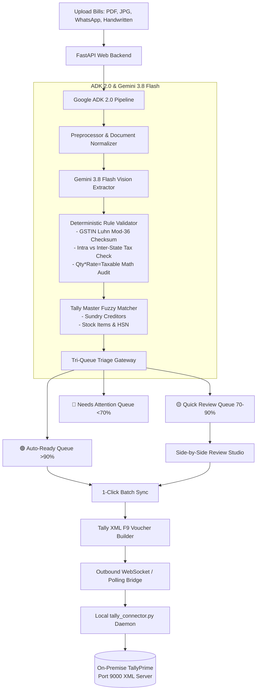

# TrulyTally AI &bull; Indian GST Invoice OCR &amp; TallyPrime Sync

[](https://github.com/google/adk-python)
[](https://ai.google.dev/)
[](https://tallysolutions.com/)

**TrulyTally AI** is an enterprise-grade AI-powered Indian GST invoice OCR platform and local Tally connector. Built with **Google ADK 2.0** and **Gemini 3.8 Flash**, it extracts GST invoice data (digital PDFs, scanned images, WhatsApp photos, and handwritten bills) with high field-level accuracy, performs deterministic GSTIN checksum and Indian tax math validation, and synchronizes directly into on-premise **TallyPrime via Port 9000 XML**.

---

## 🏗️ Architecture & Workflow



---

## 🌟 Key Features

1. **Omnichannel Ingestion & OCR**:
   - Digital PDFs (single and multi-page)
   - JPG, PNG, and TIFF scanned documents
   - Mobile camera captures & WhatsApp invoice photos
   - Handwritten bills (kirana cash memos, transport receipts, job-work challans)

2. **Deterministic Indian GST Validation**:
   - **Luhn mod-36 GSTIN Checksum**: Validates the 15-character structure and 15th check digit.
   - **Tax Routing**: Verifies intra-state (CGST + SGST) vs inter-state (IGST) tax logic against supplier and buyer state codes.
   - **Financial Reconciliation**: Checks `taxable == (quantity * rate) - discount` and `grand_total == taxable + taxes + round_off`.

3. **Tri-Queue Triage System**:
   - 🟢 **Auto-Ready (>90% + math verified)**: Ready for instant 1-click batch sync.
   - 🟡 **Quick Review (70–90%)**: Flags unmapped masters or minor rounding differences.
   - 🔴 **Needs Attention (<70%)**: Flags tax discrepancies or poor document scans.

4. **Native TallyPrime Port 9000 Integration**:
   - Zero port forwarding needed on local networks.
   - Generates standard `<VOUCHER VCHTYPE="Purchase" ACTION="Create">` F9 XML envelopes.
   - Auto-provisions missing Sundry Creditor ledgers and Stock Items on-the-fly.

5. **Built-in Virtual Tally Simulator**:
   - Run tests and demos on macOS/Linux without needing a Windows machine running Tally.

---

## 🚀 Quick Start (Local Setup)

### 1. Prerequisites
- Python 3.10+
- Node.js 18+ (for frontend)

### 2. Install Dependencies

```bash
# Clone the repository
cd ocr-adk

# Install Python backend dependencies using uv
uv sync

# Install React frontend dependencies
cd frontend
npm install
cd ..
```

### 3. Configure Environment Variables (.env)

Create or edit `.env` in the root directory (or copy from `.env.example`):

```bash
cp .env.example .env
```

Set your configuration values inside `.env`:
```dotenv
GEMINI_API_KEY="your-gemini-api-key"
GEMINI_MODEL="gemini-2.5-flash"  # or gemini-3.8-flash
```
*(Note: If `GEMINI_API_KEY` is not provided, the platform automatically runs in high-fidelity demo mode with realistic Indian GST invoices).*

### 4. Launch TrulyTally AI

```bash
# One-click launcher: starts Backend (Port 8000), Virtual Tally (Port 9000), and Connector
uv run python run.py
```

In a second terminal window, run the Vite frontend:
```bash
cd frontend
npm run dev
```

Open your browser at `http://localhost:5173`.

---

## 🖥️ Connecting to Live TallyPrime (Windows)

### Step 1: Enable XML Server in TallyPrime
1. Open TallyPrime.
2. Press **F12** (Configure) &gt; **Advanced Configuration**.
3. Set **Tally is acting as**: `Server` or `Both`.
4. Set **Port**: `9000`.
5. Accept and restart TallyPrime.

### Step 2: Run the Local Sync Connector
On the Windows computer where TallyPrime is running, execute:
```bash
python tally_connector.py --server http://<YOUR_APP_URL>:8000 --tally-port 9000
```
The header badge in the web application will turn green (`🟢 Tally Connected: <Your Company Name>`).

---

## ☁️ Deploying to Google Cloud Platform (GCP Cloud Run)

You can deploy the containerized web platform to GCP Cloud Run with a single command:

```bash
# Build and deploy container to Cloud Run
gcloud run deploy truly-tally-ai \
  --source . \
  --platform managed \
  --region asia-south1 \
  --allow-unauthenticated \
  --set-env-vars GEMINI_API_KEY="your-gemini-api-key"
```

Once deployed, your accountant runs `python tally_connector.py --server https://<CLOUD_RUN_URL>` locally on their Windows machine to securely bridge the cloud platform to their local TallyPrime!

---

## 🧪 Running Automated Tests

Run the full pytest suite for GSTIN checksum, tax math validation, and Tally XML generation:

```bash
uv run pytest backend/tests/
```
